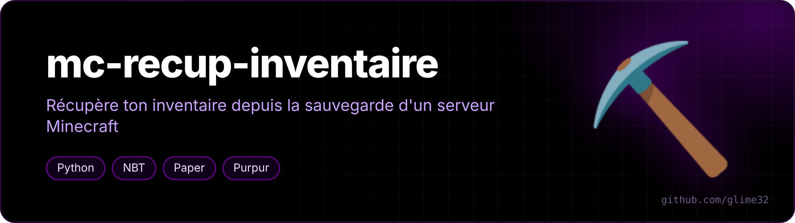

<p align="center"></p>

<p align="center">  </p>

<p align="center"><a href="README.md">🇬🇧 English version</a></p>

Récupère l'inventaire d'un joueur depuis la sauvegarde d'un serveur Minecraft (Paper, Purpur, Spigot...) et le remet dans une copie solo du monde.

## Le problème

Quand un serveur ferme, on peut récupérer son monde depuis une sauvegarde `.tar.gz` de l'hébergeur et le jouer en solo. Sauf qu'en arrivant dedans, on a un inventaire vide : en solo, Minecraft utilise le joueur stocké dans `level.dat` (qu'il crée vide) et ignore les fichiers `playerdata/` du serveur. Pire, en quittant le monde il écrase ton fichier joueur avec la version vide.

## Ce que fait le script

1. parcourt l'archive sans tout extraire et y trouve tes fichiers (`playerdata`, `stats`, `advancements`) dans le dossier du monde ;
2. cherche aussi l'UUID « hors-ligne » au cas où le serveur était en `online-mode=false`, et renomme le fichier avec ton vrai UUID ;
3. affiche ce qu'il a trouvé (inventaire, armure, ender chest, position) **avant de toucher à quoi que ce soit** ;
4. fait une copie de sécurité de `level.dat` et des dossiers joueurs ;
5. remet tes fichiers et enlève le joueur vide de `level.dat`.

Tu réapparais à l'endroit où tu étais quand le serveur a fermé, avec ton stuff.

## Utilisation

```bash
pip install nbtlib
python recup_inventaire.py --archive sauvegarde.tar.gz --monde-nom survie --pseudo Steve
```

| Option | |
|---|---|
| `--archive` | la sauvegarde `.tar.gz` du serveur |
| `--monde-nom` | nom du dossier du monde dans l'archive |
| `--pseudo` | ton pseudo |
| `--uuid` | ton UUID (sinon récupéré auprès de Mojang) |
| `--monde` | chemin du monde solo (sinon cherché dans les profils Modrinth App et `.minecraft`) |

Fermer Minecraft avant de valider. Testé avec une sauvegarde MineStrator et Minecraft Java via Modrinth App.
