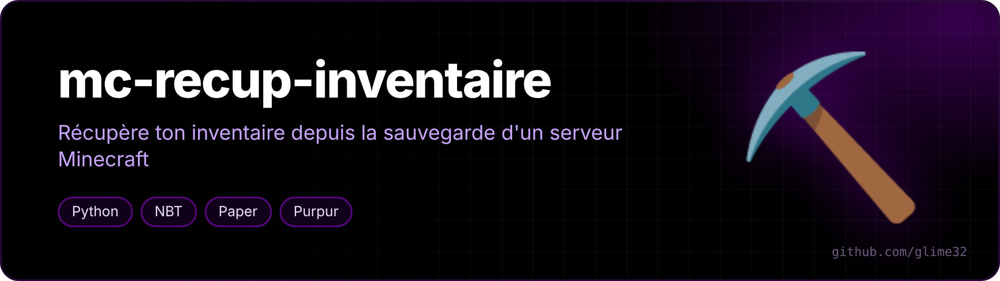
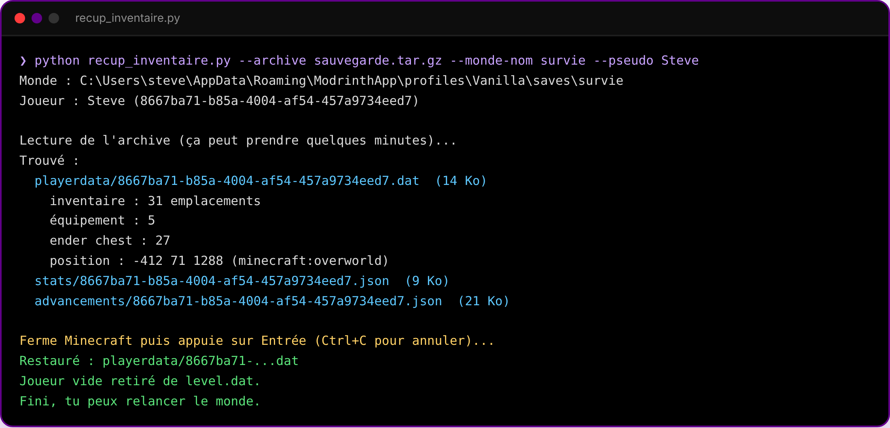

<p align="center"></p>

<p align="center">  </p>

<p align="center"><a href="README.fr.md">🇫🇷 Version française</a></p>

**Get your inventory back from a Minecraft server backup** (Paper, Purpur, Spigot…) into a singleplayer copy of the world.

## The problem

When a server shuts down, you can grab its world from the host's `.tar.gz` backup and play it solo. But you spawn with an empty inventory: in singleplayer Minecraft uses the player stored in `level.dat` (which it creates empty) and ignores the server's `playerdata/` files. Worse, when you leave, it overwrites your player file with the empty one.

<p align="center"><br><sub>example run</sub></p>

## What it does

1. scans the archive without extracting everything and finds your files (`playerdata`, `stats`, `advancements`);
2. also looks for the offline-mode UUID (`online-mode=false` servers) and renames it to your real UUID;
3. shows what it found (inventory, armor, ender chest, position) **before touching anything**;
4. backs up `level.dat` and the player folders;
5. restores your files and removes the empty player from `level.dat`.

## Use it

```bash
pip install nbtlib
curl -O https://raw.githubusercontent.com/glime32/mc-recup-inventaire/main/recup_inventaire.py
python recup_inventaire.py --archive backup.tar.gz --monde-nom world --pseudo YourName
```

| Option | |
|---|---|
| `--archive` | server backup `.tar.gz` |
| `--monde-nom` | world folder name inside the archive |
| `--pseudo` | your username |
| `--uuid` | your UUID (otherwise fetched from Mojang) |
| `--monde` | path to the singleplayer world (otherwise found in Modrinth App profiles and `.minecraft`) |

Close Minecraft before confirming.
